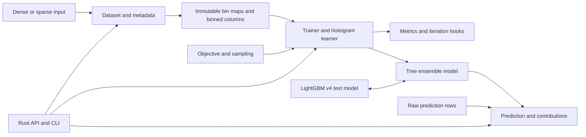

# Pure-Rust LightGBM rewrite plan

Status: In progress. Implementation and a pull request are authorized by the execution request. Package publication, version tags, release workflows, and deployment replacement are not authorized.

## Goal

Replace LightGBM's C++ training and prediction code, and its Python training workflows, with a Rust library and CLI.

The first delivery target is single-machine CPU training and prediction. Deliver a small working implementation first, then extend it to the CPU feature scope below. Do not describe the first milestone as a complete LightGBM replacement.

“Pure Rust” means:

- Training, prediction, model I/O, metrics, callbacks, and cross-validation execute in Rust.
- Product builds and execution do not require Python, `lib_lightgbm`, C++, CMake, OpenMP, Eigen, or native numerical libraries.
- Rust dependencies can use standard operating-system interfaces. Audit them for native ML or numerical dependencies.
- C++ and Python are permitted only in isolated development tools that produce reference evidence. Normal Cargo tests use saved fixtures.

## Context

The repository currently contains `README.md`, `LICENSE`, and `.gitignore`. It has no Cargo package, implementation, tests, or CI configuration.

An upstream checkout exists at `references/LightGBM/`. The root `.gitignore` excludes it, so it cannot be a build dependency or the only copy of test evidence.

Reference inspected for this plan:

- Repository: <https://github.com/lightgbm-org/LightGBM>.
- Commit: `5d84f3f222b41409a6983d2ac90513ad9702fa9e`.
- `VERSION.txt`: `4.7.0.99`, a development snapshot, not a stable release contract.
- Text model format: `v4`, defined in `src/boosting/gbdt_model_text.cpp`.
- License: MIT. Preserve upstream notices for translated code and copied test material.

### Source map

Paths in this table are relative to `references/LightGBM/`.

| Responsibility | Reference sources |
| --- | --- |
| Parameters, aliases, precision, and random generation | `include/LightGBM/{config.h,meta.h,utils/random.h}`, `src/io/{config.cpp,config_auto.cpp}` |
| Dataset construction, bins, sparse data, and metadata | `src/io/{bin.cpp,dataset.cpp,dataset_loader.cpp,metadata.cpp}`, `include/LightGBM/{bin.h,dataset.h,feature_group.h}` |
| Histograms, split selection, and tree growth | `src/treelearner/{serial_tree_learner.cpp,feature_histogram.hpp,feature_histogram.cpp,split_info.hpp,data_partition.hpp}` |
| Constraints, sampling, linear leaves, and quantization | `src/treelearner/{col_sampler.hpp,monotone_constraints.hpp,cost_effective_gradient_boosting.hpp,linear_tree_learner.cpp,gradient_discretizer.cpp}` |
| Ensemble algorithms and score updates | `src/boosting/{gbdt.cpp,score_updater.hpp,bagging.hpp,goss.hpp,dart.hpp,rf.hpp}` |
| Objectives and metrics | `src/objective/`, `src/metric/` |
| Prediction, contributions, and model I/O | `include/LightGBM/tree.h`, `src/io/tree.cpp`, `src/boosting/{gbdt_prediction.cpp,gbdt_model_text.cpp,prediction_early_stop.cpp}` |
| Python training and cross-validation behavior | `python-package/lightgbm/{engine.py,callback.py,basic.py}` |
| Behavioral tests | `tests/python_package_test/{test_engine.py,test_basic.py,test_consistency.py}`, `tests/cpp_tests/` |

### Scope and milestones

| Area | First CPU milestone | Extended CPU target |
| --- | --- | --- |
| Data | Dense numeric input, labels, weights, NaN handling, shared validation bins | CSR/CSC, categorical features, initial scores, query groups, positions, subsets, CSV/TSV and LibSVM |
| Learning | Serial histogram learner, best-first growth, GBDT, L2 and binary objectives | Remaining CPU objectives; multiclass and ranking; DART, RF, GOSS; sampling; constraints; linear leaves; quantized gradients |
| Evaluation | L2/RMSE and binary log loss; validation history | All pinned CPU metrics and Rust custom metrics |
| Prediction | Raw/transformed output, leaf indices, supported `v4` model import/export | Contributions, importance, iteration ranges, prediction early stopping, linear leaves |
| Workflow | Rust training API and save/load/predict example | Ordered callbacks, schedules, early stopping, cross-validation, continuation, refit, rollback, CLI |
| Performance | Correct serial implementation | Sparse optimization, exclusive feature bundling, bounded histogram cache, CPU parallelism |

Out of scope for this plan:

- GPU, CUDA, ROCm, multi-GPU, and distributed feature/data/voting learners. These require separate plans after CPU conformance.
- Python, R, C ABI, scikit-learn, Dask, plotting, pandas, Arrow, and Polars adapters.
- Python pickle compatibility, upstream binary dataset compatibility, and C++ prediction-code generation.
- A drop-in replacement for every Python method or CLI argument, or bit-identical training across hardware and compilers.

These exclusions are not implemented features. Unsupported parameters, model capabilities, and input formats must produce explicit errors. Document label encoding and categorical codebook responsibilities for callers that previously relied on Python adapters.

## Architecture

Start with one Cargo package: library `lightgbm_rust` and binary `lightgbm-rust`. Keep implementation modules in that package. Do not create separate crates for each algorithm.



- `Dataset` owns validated metadata and binned storage. Validation datasets reuse training bin maps. Feature indexes must remain traceable after filtering and bundling.
- `Trainer` owns mutable scores, gradients, Hessians, row partitions, random state, and histogram buffers. Keep this state separate from the prediction model.
- `Model` owns tree arrays, feature metadata, objective transforms, and iteration layout. Prediction must not require a training dataset or rebinned input.
- Objective code owns initialization, derivatives, output conversion, and objective-specific leaf renewal. A gradient/Hessian trait alone is insufficient.
- Training hooks receive typed state at documented before/after iteration points. Do not expose mutable internal buffers through the public API.
- Keep large data in contiguous arrays. Begin with safe Rust and explicit loops; optimize only after conformance tests exist.
- Match the reference precision contract: default labels, weights, gradients, and Hessians use `f32`; prediction scores and relevant accumulators use `f64`. Record each conversion boundary.

### Tech stack

- Stable Rust, with a pinned toolchain and a tested `rust-version` in `Cargo.toml`.
- Add `serde`/`serde_json` for structured fixtures and reports, `csv` for delimited input, and Rayon when parallel execution is implemented. Do not add unused dependencies.
- Use property tests for invariants and Criterion for local performance tests. Keep reference tooling under `tools/oracle/`, outside the product dependency graph and published package.

### Validation contract

Use separate evidence for prediction correctness, training correctness, model quality, and performance.

- Imported-model predictions must match the reference for the same model and input.
  - Initial numerical bound: `abs(actual - expected) <= 1e-12 + 1e-10 * abs(expected)`.
  - Leaf indexes, shapes, category membership, and iteration selection must match exactly.
- Primitive fixtures must cover bin maps, random sequences, gradients/Hessians, histograms, gains, and chosen splits.
  - Initial `f32` derivative bound: `1e-6 + 1e-5 * abs(expected)`.
  - Fix separate bounds for double-precision kernels before their implementation. Record any change with reference evidence; do not loosen bounds to hide a defect.
- Tiny serial training fixtures must match tree structure exactly, with bounded numerical differences in leaf values. Set all relevant seeds and a fixed reference histogram mode.
- Larger training cases must satisfy predeclared metric bounds. Similar model quality alone does not establish algorithm conformance.
- Deterministic execution must be repeatable for a documented build and thread configuration. Test cross-thread-count behavior separately; do not assume it.
- Compare release builds on the same host, inputs, parameters, thread counts, and preprocessing boundary.
  - Initial performance budgets: median training time at most `1.5x`, prediction time at most `1.25x`, and peak resident memory at most `1.5x` the pinned reference on the declared benchmark cases.
  - Measure dataset construction separately. Use warm-up and at least five measured runs. Record hardware, compiler, build flags, data size, sparsity, and model quality.
  - Phase 0 fixes the benchmark cases and quality bounds before optimization starts. A missed budget remains open; it is not a correctness waiver.

## Execution evidence

- All product targets passed `cargo test --locked --all-targets` on native macOS ARM64 after the empty-query sampling correction. Normal tests use saved fixtures only.
- The native oracle integration passed 399 artifact hashes and 126 deliberate mutation rejections. The final integration includes 15 extended workflow, 68 AUC-mu edge, and 14 empty-query cases. Reference regeneration must be repeated after producer/checker changes.
- Dataset indexes, CV aggregate allocation limits, and finite AUC-mu inputs have dedicated safety regressions. Native-undefined empty-query combinations return typed errors.
- Final-source quality, fixed-baseline timing, matched memory and native inference pass. Dense and multiclass native training pass. Sparse, categorical and ranking native training remain above 1.5x after measured optimization. This required gate remains open; no exception is authorized.
- Format, Clippy, all-target tests, doctests, offline tests, Criterion and extracted-package tests pass on native macOS ARM64. Final clean package verification, native CI and pull-request delivery remain pending. Retain this plan while required gates are open.

## Plan

Tasks are dependency-ordered. Add reference fixtures before implementing each feature family. Each phase must preserve the gates of earlier phases. A phase can contain several small pull requests; no calendar estimate is assumed.

### Phase 0 — Fix the compatibility contract

- [x] Write `docs/compatibility.md` with the CPU feature matrix and parameter dispositions.
  - Evidence: every pinned parameter family and public workflow is marked supported, planned, mapped to a Rust equivalent, or explicitly outside scope. Define alias precedence, invalid combinations, category encoding, iteration counts, and prediction shapes.
- [x] Define a reference manifest schema and save the pinned source record.
  - Evidence: the record contains the upstream URL, commit, license provenance, precision macros, histogram mode, seeds, and thread counts. The schema requires compiler and loaded-library identity from Phase 1. Use this inspected commit unless a separately documented baseline change replaces it.
- [x] Specify deterministic conformance datasets and benchmark cases for dense, sparse, categorical, multiclass, and ranking workloads.
  - Evidence: reproducible generators or small text inputs define expected assertions, numerical/quality bounds, resource limits, and performance budgets before porting those cases.

### Phase 1 — Build the Rust foundation and test oracle

- [x] Create the Cargo package, toolchain files, typed errors, and minimal library test.
  - Evidence: formatting, Clippy, unit tests, and documentation tests pass with the declared minimum Rust version. No product build invokes Python or C++.
- [x] Implement typed parameter validation and upstream-name translation for the supported subset.
  - Evidence: tests cover defaults, ranges, aliases, precedence, conflicts, and explicit rejection of unsupported parameters. Extend this validation when each later feature becomes supported.
- [x] Create an isolated oracle workflow that builds and loads the pinned CPU reference.
  - Evidence: populate the manifest with compiler/build details and loaded-library path/hash. A version check proves that the oracle uses the intended checkout, not an unrelated installed wheel. Prepare compiler/CMake dependencies locally; invoke Python scripts with `uv run python`. If prerequisites cannot be prepared, leave dependent tasks blocked and record the required tool access.
- [x] Generate the first compact text fixtures for numeric prediction, L2/binary kernels, bins, histograms, splits, and random sequences.
  - Evidence: fixtures include inputs, parameters, outputs, provenance, and checksums. A reference test driver supplies internal values not exposed by Python; keep its build isolated from Cargo.
- [x] Implement a Rust fixture runner with a coverage report.
  - Evidence: a deliberate value/shape mutation fails comparison, missing required cases fail coverage, and normal fixture tests run without `references/LightGBM/` or Python installed.

### Phase 2 — Implement model representation and inference

- [x] Implement tree/ensemble storage and a checked `v4` text model reader.
  - Evidence: numeric and categorical reference models load with correct feature mapping, missing/default directions, class layout, and objective metadata. Malformed indexes, cycles, truncated arrays, and unsupported linear models return errors.
- [x] Implement dense/sparse traversal, raw/transformed predictions, leaf indexes, and iteration ranges.
  - Evidence: oracle comparisons cover numeric boundary values, NaN, near-zero missingness, negative/unseen category codes, empty class cases, sigmoid/softmax/link transforms, and RF averaging. Distinguish raw category-code behavior from Python codebook alignment.
- [x] Implement text model export and structured model inspection.
  - Evidence: reference-to-Rust-to-reference round trips preserve predictions and required metadata. Verify tree byte lengths, multiclass tree ordering, and single-leaf trees; do not require identical whitespace.

### Phase 3 — Implement datasets and binning

- [x] Implement checked dense, CSR, and CSC dataset builders with typed metadata.
  - Evidence: tests cover layouts, feature names, label/weight domains, initial-score shapes, query boundaries, positions, sparse index widths, explicit zeros, duplicate-index policy, and invalid dimensions without panics.
- [x] Port sampled numerical/categorical bin construction and seed derivation.
  - Evidence: reference fixtures match thresholds, default/missing bins, integer category conversion, feature filtering, forced bins, constant columns, `max_bin`, `min_data_in_bin`, and sample selection.
- [x] Implement owned compact bin storage, subsets, and shared validation mappings.
  - Evidence: dense/sparse equivalent inputs produce equivalent bins and histograms; validation never learns independent thresholds. Tests verify original feature indexes and group-safe subsets. Retain raw numerical values only when linear leaves require them.

### Phase 4 — Implement the serial histogram tree learner

- [x] Implement gradient/Hessian histogram construction and parent-minus-child subtraction.
  - Evidence: optimized histograms match a slow direct implementation and reference fixtures across dense/sparse data, empty bins, constant Hessians, and missing values. Bound temporary storage and test subtraction roundoff.
- [x] Port numerical split scoring and leaf-output calculation.
  - Evidence: exhaustive tiny-data checks cover L1/L2 regularization, minimum gain/count/Hessian, epsilon placement, maximum leaf output, missing direction, scan order, and tie-breaking. Preserve reference count estimation where it uses Hessian proportions.
- [x] Implement best-first leaf growth and row partition updates.
  - Evidence: tiny trees match the oracle for `num_leaves`, `max_depth`, unsplittable roots, and equal-gain candidates. Partition tests prove each row reaches exactly one leaf; depth limits must not change growth to level-wise.

### Phase 5 — Deliver the first working CPU training path

- [x] Implement L2 and binary objectives with their baseline metrics.
  - Evidence: initialization, derivatives, weights, class weighting, stable transforms, and metric edge cases match primitive fixtures; finite differences check smooth losses.
- [x] Implement the GBDT iteration loop and validation score updates.
  - Evidence: multi-round tests match reference scores, learning-rate shrinkage, initial scores, stop-on-no-split behavior, tree counts, and iteration history without sampling enabled.
- [x] Add a Rust train-save-load-predict example for regression and binary classification.
  - Evidence: both tasks pass tiny structural parity and larger quality gates; the upstream library also predicts from the Rust-exported models. Document the remaining unsupported features.

First milestone exit: a useful pure-Rust CPU implementation exists. Extended CPU conformance is still incomplete.

### Phase 6 — Extend objectives, categorical learning, and metrics

- [x] Implement categorical split search.
  - Evidence: tests match one-hot and sorted-category partitions, category smoothing/L2 penalties, group limits, missing codes, high cardinality, and stable ordering.
- [x] Implement multiclass softmax and one-vs-all training.
  - Evidence: oracle tests verify class-major derivative layout, Hessian scaling, absent classes, per-iteration tree ordering, transformed output, and multiclass error/log loss.
- [x] Implement L1, quantile, Huber, Fair, Poisson, MAPE, Gamma, and Tweedie objectives.
  - Evidence: objective fixtures cover parameter/label restrictions, weighted initialization, stability limits, and residual-percentile leaf renewal where required. Do not replace non-smooth leaf renewal with a generic Newton update.
- [x] Implement cross-entropy and cross-entropy-lambda objectives.
  - Evidence: fractional labels, weights, initial scores, derivatives, and output transforms match the reference, including invalid-domain errors.
- [x] Implement LambdaRank and XE-NDCG objectives with query metadata and position-bias handling.
  - Evidence: fixtures cover gain tables, tied scores, empty/short queries, query weights, truncation, normalization, random sequences, position updates, and output scores that exclude position bias.
- [x] Complete the pinned CPU metric registry.
  - Evidence: parameterized fixtures cover every CPU factory entry, including AUC/AP/AUC-mu, NDCG/MAP cutoffs, R², KL, regression metrics, metric direction, default selection, and disabled metrics. Test single-class AUC, constant targets, zero-relevance queries, and unknown metric rejection.

### Phase 7 — Complete extended CPU learning behavior

- [x] Implement row, class-balanced, query, tree-feature, and node-feature sampling.
  - Evidence: sampled indexes and random-call order match seeded fixtures; query sampling preserves complete groups and feature sampling uses the declared eligible features.
- [x] Implement GOSS sampling and rescaling.
  - Evidence: fixtures match warm-up iterations, selection statistics, multiclass aggregation, and gradient/Hessian rescaling. Verify unsupported combinations fail explicitly.
- [x] Implement DART and RF ensemble update rules.
  - Evidence: seeded fixtures match dropout selection/normalization, warm-up behavior, RF averaging, and relevant objective/sampling restrictions; GBDT tests remain unchanged.
- [x] Implement monotonicity methods, interaction constraints, forced splits, extra trees, path smoothing, feature penalties, and cost-efficient boosting.
  - Evidence: each control has an isolated oracle case and a stated invariant; add combination cases for shared split-scoring and sampling paths. Test rejected and infeasible constraints.
- [x] Implement linear-leaf training and inference with a pure-Rust solver.
  - Evidence: coefficient and prediction fixtures cover regularization, rank-deficient systems, missing features, categorical interactions, first-tree behavior, and model round trips. The dependency audit excludes Eigen/BLAS/LAPACK.
- [x] Implement gradient quantization and leaf renewal.
  - Evidence: quantization bounds, seeded rounding, integer accumulation, overflow limits, and renewed outputs match reference cases. Recheck ranking and categorical quality.
- [x] Implement model continuation, refit, iteration rollback, and supported model/leaf operations from the compatibility matrix.
  - Evidence: score/state consistency tests match reference workflows and reject incompatible datasets/models. Separate model warm starts from exact training-state checkpoints; do not promise RNG restoration that model files cannot supply.
- [x] Implement TreeSHAP contributions, split/gain importance, and prediction early stopping.
  - Evidence: contributions match the oracle and sum to raw predictions including the bias term. Verify sparse/multiclass shapes and the reference restrictions for linear trees, RF, and custom objectives.

### Phase 8 — Replace Python orchestration with Rust workflows

- [x] Implement ordered training hooks, schedules, evaluation history, best scores, and early stopping.
  - Evidence: reference workflow tests cover before/after ordering, multiple validation sets/metrics, metric direction, `first_metric_only`, `min_delta`, training-set exclusion, final-round handling, and disabled DART stopping. Use Python `engine.py`/`callback.py` semantics; do not silently substitute the different C++ CLI stopping policy.
- [x] Implement Rust custom objective and metric interfaces.
  - Evidence: custom derivatives/metrics reproduce equivalent built-in cases. Invalid output lengths and numerical domains fail before learner access; callbacks cannot leave a partially committed iteration.
- [x] Implement Rust cross-validation.
  - Evidence: explicit folds and seeded standard/stratified/group-safe folds reproduce declared splits and aggregation, including population standard deviation, common stopping iteration, and history truncation.
- [x] Implement the CLI and delimited/LibSVM input adapters over the same Rust API.
  - Evidence: train, predict, and refit integration cases match library results; invalid parameters/data return useful errors and nonzero exit codes. Document precedence and supported upstream aliases instead of accepting unused options.

### Phase 9 — Optimize CPU execution without changing semantics

- [x] Add bounded parallel histogram construction, split search, and batch prediction with Rayon.
  - Evidence: serial/parallel conformance tests cover fixed reduction order, deterministic ties, repeated runs, thread limits, and nested cross-validation without uncontrolled oversubscription.
- [x] Implement sparse histogram optimizations and exclusive feature bundling.
  - Evidence: bundled/unbundled and dense/sparse paths preserve feature identity, predictions, and permitted split behavior. Reference cases cover bundle conflicts, missing bins, and zero handling.
- [x] Implement supported row-wise/column-wise histogram modes and a bounded reusable histogram cache.
  - Evidence: both modes pass conformance; eviction/recomputation preserves results and measured allocations stay within the declared memory budget. Document mode selection and deterministic behavior.
- [ ] Run the fixed performance suite and optimize measured bottlenecks.
  - Evidence: a report includes per-case construction/training/prediction time, peak memory, quality, and reference ratios for single-threaded and bounded parallel runs. Every required case meets the Phase 0 budgets, not only the average.

### Phase 10 — Verify the CPU release candidate

- [x] Add bounded fuzz/property tests for model readers, sparse inputs, configuration, tree structure, and numerical edge cases.
  - Evidence: recorded runs complete without crashes, invalid memory access, cycles, unchecked allocation arithmetic, or invalid model output. Test NaN/infinity, constant data, degenerate labels, large category IDs, and malformed metadata.
- [x] Write API examples, migration notes, and the final compatibility report.
  - Evidence: documentation tests pass; every in-scope matrix entry links to passing evidence. Explain changed Python workflows, missing ecosystem adapters, category/label encoding, model-format limits, and reproducibility limits.
- [ ] Configure native CI checks and a product-only build environment without Python or native LightGBM build dependencies.
  - Evidence: available native runners pass format/lint/unit/integration/doc/fixture gates. Prove a Rust-only product build and run. Claim Linux, macOS, or Windows support only for platforms with native test evidence; record unavailable runners in the handoff.
- [ ] Verify the package contents, dependencies, and complete release-candidate checks.
  - Evidence: the commands below pass; dependency/build-script and linked-library inspection find no native ML/numerical dependency. `cargo package` excludes the ignored checkout and oracle tooling, includes required notices, and verifies the package. Record the oracle regeneration and performance reports separately from normal Cargo tests.

Planned commands after the package exists; these are not claims about checks run while drafting this document:

```sh
cargo fmt --all -- --check
cargo clippy --locked --all-targets -- -D warnings
cargo test --locked --all-targets
cargo test --locked --doc
cargo bench --locked
cargo package --locked
```

After dependencies are fetched, repeat fixture tests with `--offline`. A benchmark command passing does not establish that its timing budgets passed; inspect the recorded results.

## Risks

| Risk | Required control |
| --- | --- |
| The development snapshot changes or differs from an installed wheel | Pin source and binary identity; regenerate evidence only through a recorded baseline change. |
| Small numerical differences change the entire tree sequence | Match precision boundaries, bins, random calls, and tie order; compare intermediate states before final quality. |
| Python and C++ orchestration have different behavior | Select the Python training workflow contract explicitly and test it independently from the learner. |
| Missing/categorical behavior is oversimplified | Test raw-code traversal separately from dataset binning and Python category alignment. |
| Linear solvers, quantization, or parallel reductions change results | Maintain serial fixtures, numerical invariants, and feature-specific tolerances before optimization. |
| CPU scope grows without a usable delivery | Preserve the Phase 5 milestone; keep unsupported-feature errors until later gates pass. |
| Reference tests or data have licensing or reproducibility gaps | Preserve notices; prefer small generated data; record provenance and seeds. |

## Rollback / Recovery

- Keep reference fixtures and previously passing serial paths while optimizing. Revert a failing optimization rather than changing expected outputs without evidence.
- Never overwrite an input model or dataset during conversion. Write model output through a temporary file and replace the destination only after successful serialization.
- Keep upstream models usable during migration. Validate exported models with the pinned reference before describing them as interoperable.
- Document public API and model-support changes. Do not silently change defaults or rewrite existing artifacts.
- If a release candidate fails a gate, retain the last passing artifact and keep the failing task open. This plan does not authorize replacing a deployed implementation.

## External Handoff

- Registry publication: the package maintainer needs a verified release candidate and registry credentials. The maintainer can authorize and perform publication; registry installation remains unverified until a published-package check runs. Do not publish as part of plan execution without separate authorization.
- Unavailable platform runners: the CI owner must provide a native runner before that platform can be claimed as supported. The agent prepares the job and records available build/test evidence; native behavior remains unverified and the release claim stays restricted until the runner passes.

## Completion Checklist

- [ ] All implementation tasks have passing evidence, including the extended CPU features; Phase 5 alone does not close this plan.
- [x] The pinned reference manifest and regenerable text fixtures are retained without depending on the ignored checkout.
- [x] Imported-model prediction, primitive-kernel, tiny-tree, workflow, and larger quality gates pass for every in-scope feature family.
- [ ] Required time and memory budgets pass on the declared benchmark cases with comparable model quality.
- [x] Normal builds, execution, and fixture tests work without Python, C++ compilation, CMake, OpenMP, Eigen, or `lib_lightgbm`.
- [ ] Package verification, dependency/license review, documentation examples, and available native platform gates pass.
- [ ] The retained compatibility report states all exclusions, unresolved external checks, and release restrictions; no complete-upstream-parity claim is made.
- [ ] Execution evidence and external handoff details are preserved in retained repository documents before this completed implementation plan is deleted.
